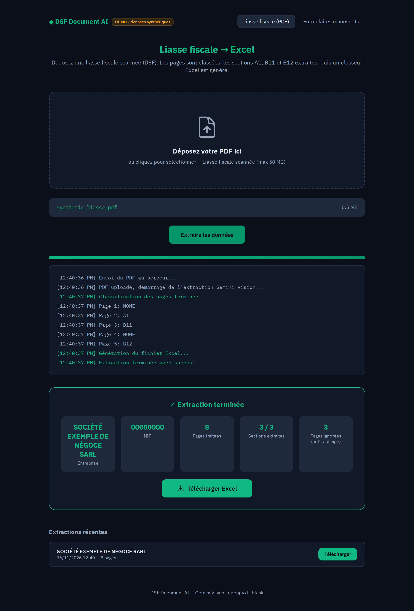
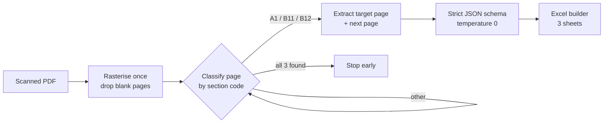
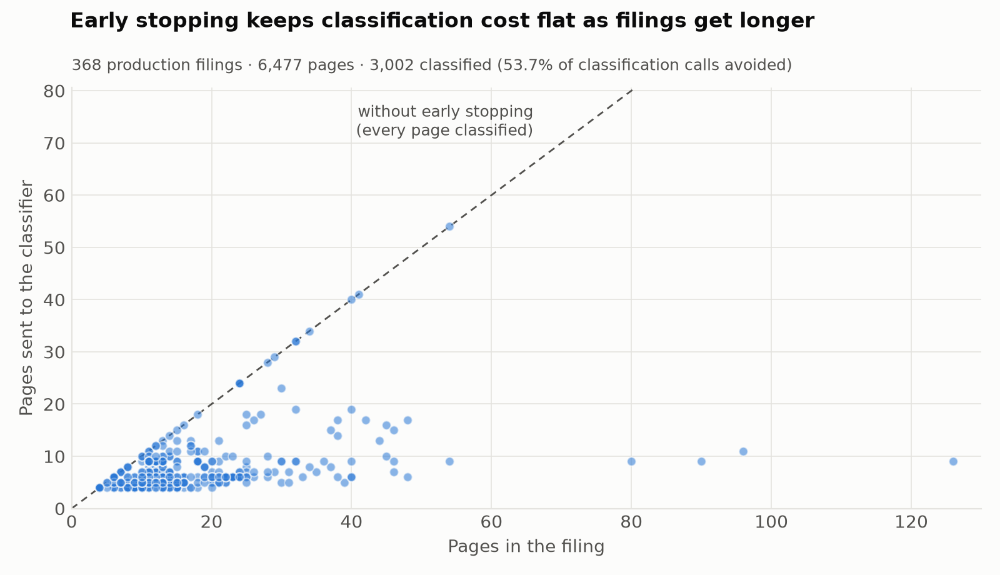
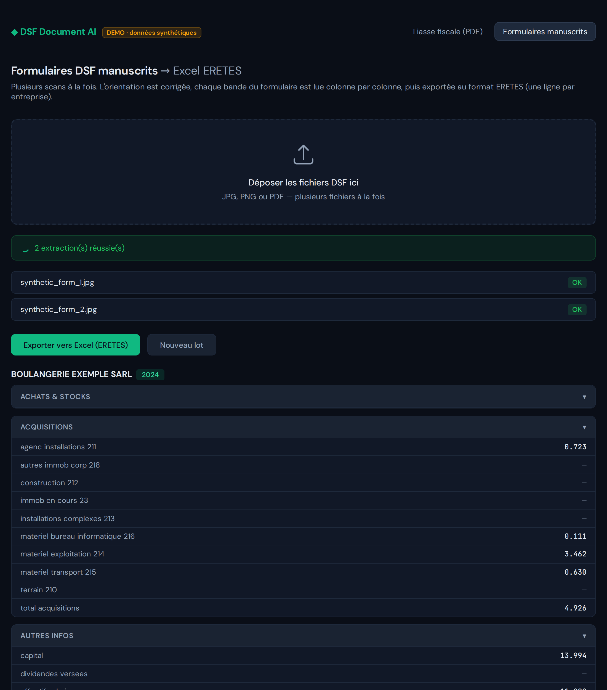
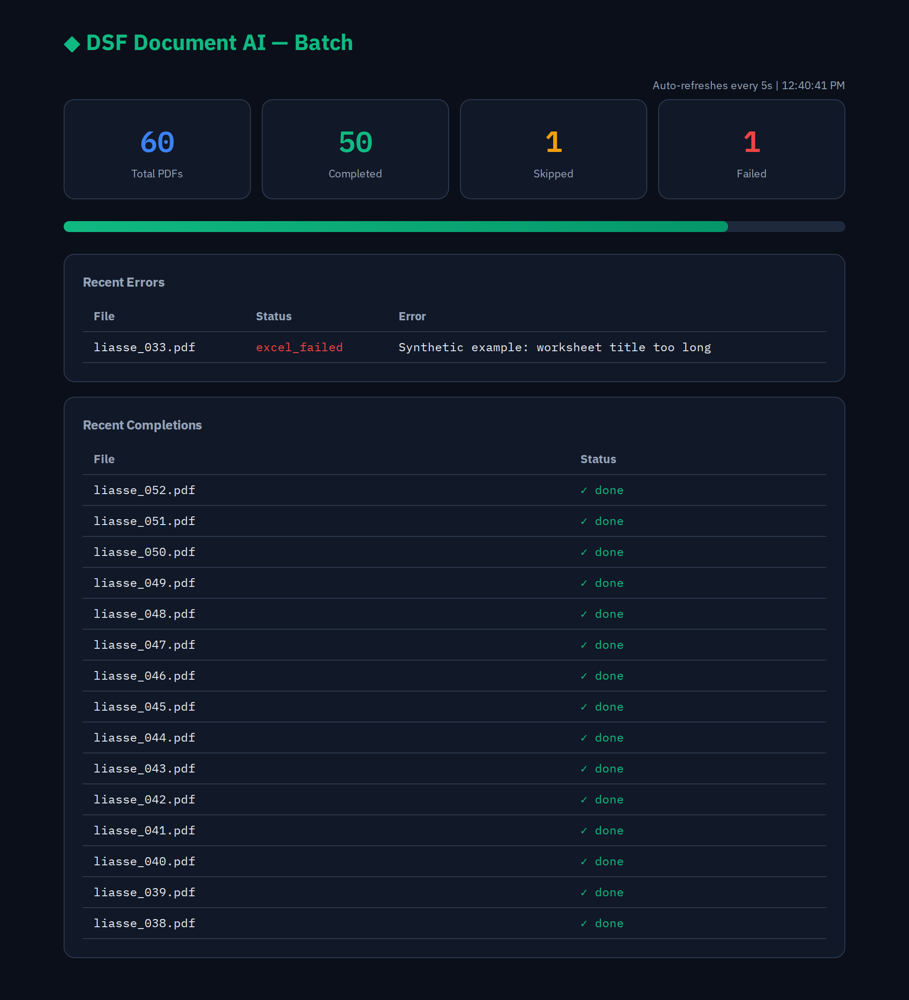
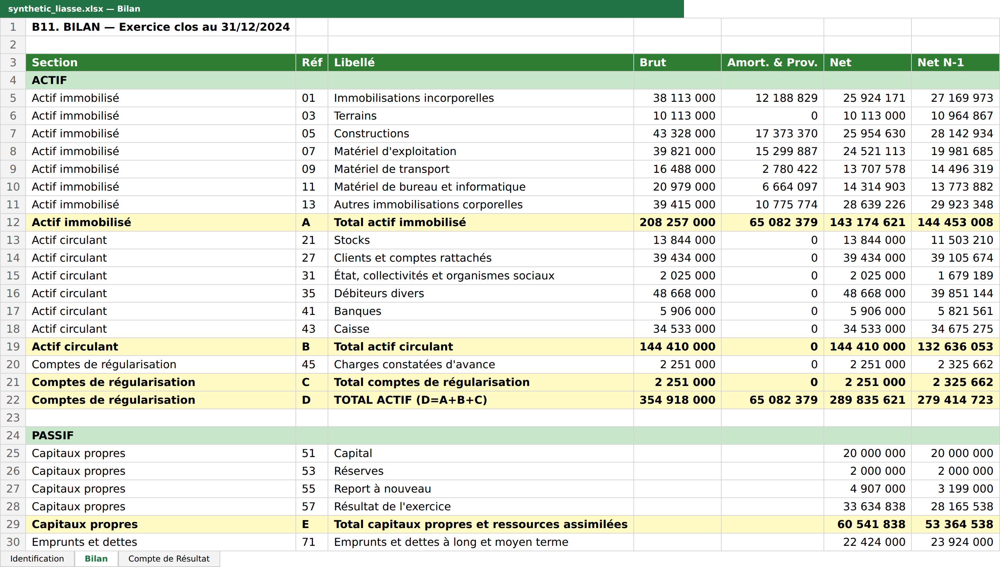

# DSF Document AI

**Turn scanned Mauritanian tax filings into analysis-ready Excel using Gemini vision models.**

Two pipelines in one app: one for typed multi-page *liasses fiscales* and one for handwritten single-page statistical forms. A crash-safe batch runner processed **427 real filings unattended**.



> All screenshots and sample files in this repository use **synthetic data** (fictional companies, `00000000` tax IDs, `example.com` contacts). No real filings are included.

---

## The problem

Every company in Mauritania files a **DSF** (*Déclaration Statistique et Fiscale*) every year. These filings are a key input to national accounts and business statistics, but most arrive as **scanned PDFs**:

- A filing runs from 4 to 120+ pages: cover letters, attestations, dozens of annex tables. Only three sections matter for statistics: **A1** (identification), **B11** (balance sheet) and **B12** (income statement).
- Pages are often rotated, sections spill over onto the next page, and every company labels rows slightly differently.
- Older filings use a **handwritten** one-page form, where amounts are written by hand under printed account codes.

Re-keying them by hand is slow and error-prone. Classic OCR breaks on the tables, rotations and handwriting.

## What it does

| Pipeline | Input | Output |
|---|---|---|
| **Liasse fiscale** | Multi-page scanned PDF | One Excel workbook per company: *Identification*, *Bilan* (Actif/Passif, Brut/Amort./Net/N-1), *Compte de Résultat* and the intermediate balances (SIG) |
| **Handwritten forms** | Many JPG/PNG/PDF scans at once | One **ERETES-format** workbook, one row per company, with the aggregate columns written as live Excel formulas |



Key design choices:

- **Classify, then extract.** A cheap prompt reads the section code from each page's green banner. Classification **stops as soon as A1, B11 and B12 have been found**, so the long annexes are never sent to the model.
- **Target page + next page.** Sections often continue on the following page (Actif on one, Passif on the next), so every extraction call sends both pages together.
- **Strict schemas, exact labels.** Prompts ask for one fixed JSON shape with integer amounts and the document's own French labels. Parsing tolerates code fences, extra prose and trailing commas.
- **Handwritten forms:** the scan is turned to landscape automatically, and the model reads each band column by column, matching every value to the code printed directly above it. An optional **Google Document AI** pass fills the diagonally split *capital / réserves* cells that the model sometimes leaves empty.
- **Built for long unattended runs:** pages are rasterised once, blank pages are removed in memory, retries back off on rate limits, progress is checkpointed after every file, the runner pauses when disk space runs low, and a live dashboard shows progress.

## Results

Production batch run on real filings: April 2026, `gemini-2.0-flash` on Vertex AI.

| Metric | Value |
|---|---|
| Filings processed unattended | **427 PDFs** in ~2 days, one command, resumable |
| Completed | **421 (98.6 %)**: 4 correctly skipped as not-a-DSF, 2 failed at the Excel-writing step |
| All three sections extracted | **88 %** of filings (372 / 423); the rest had 2 of 3 |
| Pages handled | **6,477** (median 13 per filing, max 126) |
| Classification calls avoided by early stopping | **53.7 %** (3,002 of 6,477 pages classified) |



Pages sent to the classifier stay at about 5–15 no matter how long the filing is. The dots on the diagonal are filings where a target section was missing or came last, so every page had to be read.

**What is *not* measured yet:** there is no field-level accuracy benchmark against hand-keyed ground truth. Quality was checked with an automated label-consistency test suite and manual PDF-vs-Excel spot checks. A labelled evaluation set is the next step (see [Limitations](#limitations)).

## Data protection

The production run used **Vertex AI** (Google Cloud, enterprise terms), not the consumer Gemini app or the free Gemini API. Under Google Cloud's generative AI data governance terms, Google does not use customer prompts or documents to train or fine-tune its models without permission. Data is processed only to return the result; Google may keep prompts temporarily for abuse monitoring, and its cache is deleted within 24 hours (it can be disabled per project).
No filing, extracted value or output from the production run is included in this repository.

> ⚠️ Use the Vertex AI backend for confidential documents. The **free (unpaid) Gemini API tier** allows Google to use submitted content to improve its products, so it is only suitable for the synthetic samples.

## Screenshots

| Handwritten forms → ERETES | Batch dashboard |
|---|---|
|  |  |

Generated workbook (*Bilan* sheet), built from [`samples/synthetic_liasse.pdf`](samples/synthetic_liasse.pdf):



## Tech stack

- **AI:** Google Gemini via the Google Gen AI SDK (Vertex AI or a Gemini API key), plus optional Google Document AI Form Parser
- **Imaging:** pdf2image / Poppler, Pillow, OpenCV, NumPy
- **Output:** openpyxl (styled workbooks, live formulas)
- **Web:** Flask, vanilla JS, Gunicorn, Docker
- **Batch:** rclone (Google Drive or any remote) or a local folder, with JSON checkpoints
- **Tests:** pytest, 28 tests, no network or credentials needed (the model is faked)

## Project structure

```
dsf-document-ai/
├── app.py                  # Flask web app: both pipelines + demo mode
├── batch.py                # crash-safe batch runner (local folder or rclone remote)
├── dashboard.py            # live progress dashboard for batch.py
├── dsf_ai/
│   ├── config.py           # settings from environment variables
│   ├── gemini.py           # Gemini client: retries, backoff, JSON parsing
│   ├── imaging.py          # rasterise, blank-page removal, rotation fix
│   ├── liasse.py           # pipeline 1: classify → extract (A1, B11, B12)
│   ├── liasse_excel.py     # 3-sheet workbook builder
│   ├── form.py             # pipeline 2: handwritten forms (+ Document AI patch)
│   ├── form_excel.py       # ERETES export with live formulas
│   └── demo.py             # synthetic responses for DEMO_MODE
├── templates/              # web UI (French, as used by the analysts)
├── samples/                # synthetic PDF, scans, JSON and Excel outputs
├── scripts/                # regenerate samples, figures and screenshots
├── tests/                  # pytest suite
└── docs/                   # screenshots and figures
```

## How to run

### 1. Try it without any cloud account (demo mode)

```bash
git clone https://github.com/MedouLoq/dsf-document-ai.git
cd dsf-document-ai
python -m venv .venv && source .venv/bin/activate
pip install -r requirements.txt
sudo apt install poppler-utils          # macOS: brew install poppler

DEMO_MODE=true python app.py            # open http://127.0.0.1:5000
```

Upload `samples/synthetic_liasse.pdf` on the first tab and `samples/synthetic_form_*.jpg` on the second. Demo mode returns the synthetic results and builds real Excel files.

### 2. Run against Gemini

```bash
cp .env.example .env
# Option A: Vertex AI. Set GCP_PROJECT_ID and GOOGLE_APPLICATION_CREDENTIALS
#           (path to a service-account key kept OUTSIDE the repo)
# Option B: set GEMINI_API_KEY
#           (paid/billing-enabled projects only for real documents; see Data protection)
python app.py
```

| Variable | Purpose |
|---|---|
| `GCP_PROJECT_ID`, `GCP_LOCATION`, `GOOGLE_APPLICATION_CREDENTIALS` | Vertex AI backend |
| `GEMINI_API_KEY` | Gemini API backend (used when no project is set) |
| `GEMINI_MODEL` | defaults to `gemini-2.5-flash` |
| `DOCAI_PROCESSOR_ID`, `DOCAI_LOCATION` | optional Document AI Form Parser for handwritten forms |
| `DEMO_MODE` | `true` to serve synthetic results |

See [`.env.example`](.env.example) for the full list.

### 3. Batch processing

```bash
python batch.py --source ./pdfs                     # local folder
python batch.py --source gdrive:"DSF 2024"          # any rclone remote
python dashboard.py --output batch_outputs          # live progress at :5001
```

Re-running the same command resumes from `batch_outputs/progress.json`.

### 4. Docker

```bash
docker build -t dsf-document-ai .
docker run -p 5000:5000 --env-file .env dsf-document-ai
```

### Tests

```bash
pip install -r requirements-dev.txt
pytest
```

## Limitations

- **No ground-truth accuracy benchmark yet.** The next step is a hand-keyed evaluation set with field-level precision/recall per section.
- The prompts and schemas target the **Mauritanian DSF layout**. Other countries' forms would need new prompts.
- The production run used `gemini-2.0-flash`. The default is now `gemini-2.5-flash`, and newer models should be re-checked on a sample before a large run.
- Extraction is synchronous per request. Very large PDFs belong in `batch.py`, not the web UI.

## Author

Mohamedou Loughmane ([@MedouLoq](https://github.com/MedouLoq))

## License

[MIT](LICENSE)
